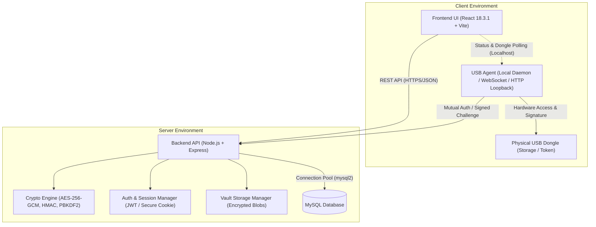
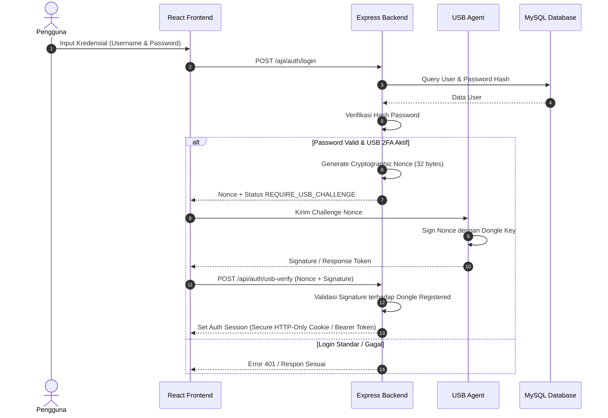
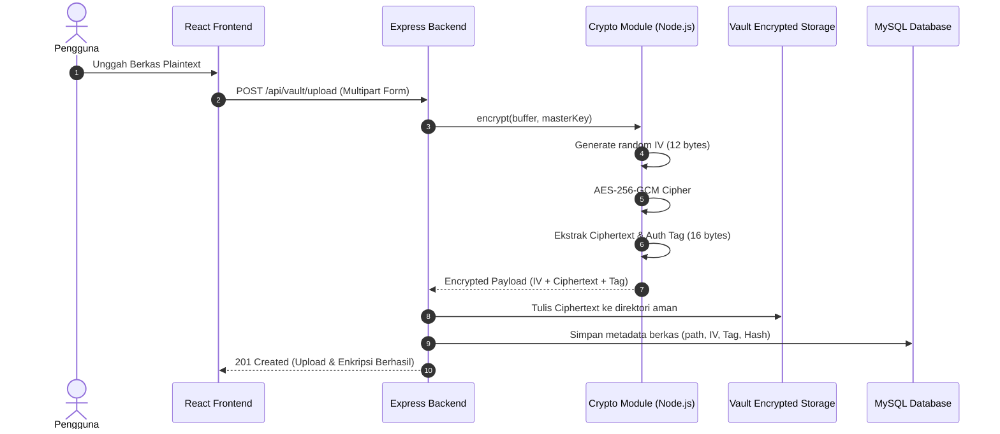
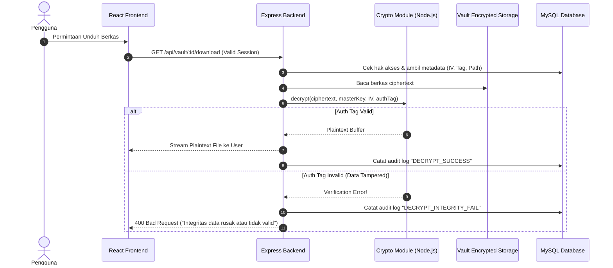

# KryptoInfo — Architecture Document

> Dokumen Arsitektur Sistem KryptoInfo  
> Versi: 1.0.0 | Status: Draft / Initial Architecture

---

## 1. Ikhtisar Sistem (System Overview)

KryptoInfo adalah sistem penyimpanan dan pengelolaan berkas/data terenkripsi tingkat tinggi (*secure cryptographic vault*) dengan otentikasi multi-faktor berbasis fisik (USB Dongle / USB Agent). Sistem dirancang dengan prinsip **Zero Trust**, pemisahan tanggung jawab (*separation of concerns*), dan isolasi kompartemen keamanan kriptografi.

Sistem terdiri dari 3 subsistem utama yang saling terisolasi:
1. **Frontend (KryptoInfo UI)**: Single Page Application berbasis **React 18.3.1** dengan Vite.
2. **Backend (KryptoInfo Core API)**: REST API berbasis **Node.js** dan **Express** yang menangani orkestrasi bisnis, autentikasi sesi, dan eksekusi kriptografi server.
3. **USB Agent (KryptoInfo Dongle Daemon)**: Agen lokal terpisah yang berinteraksi langsung dengan storage/hardware USB fisik secara aman untuk *challenge-response authentication* dan penyimpanan *hardware-bound credentials*.
4. **Database (MySQL)**: Penyimpanan data relasional terstruktur untuk metadata pengguna, log audit terenkripsi, referensi berkas vault, dan session state.

---

## 2. Diagram Arsitektur Komponen

---

## 3. Komponen Subsistem

### 3.1. Frontend (`frontend/`)
- **Framework**: React 18.3.1 murni (functional components & hooks).
- **Build Tool**: Vite (bundler modern, cepat, dan ringan).
- **Peran**:
  - Menyajikan antarmuka visual yang modern, responsif, dan aksesibel.
  - Menampilkan status enkripsi, daftar berkas dalam vault, log aktivitas, serta status deteksi dongle USB.
  - Memfasilitasi upload dan download ciphertext berkas.
- **Batasan Keamanan Ketat**:
  - **TIDAK MENYIMPAN** *master encryption key* maupun *private key* di memori browser, `localStorage`, `sessionStorage`, ataupun cookies.
  - Tidak mengeksekusi algoritma kriptografi inti di browser yang dapat dimanipulasi oleh inspeksi DOM / memory injection.

### 3.2. Backend API (`backend/`)
- **Runtime**: Node.js (v18+)
- **Framework**: Express.js
- **Peran**:
  - Menyediakan endpoint RESTful API terstruktur dan terlindungi middleware.
  - Validasi ketat pada setiap payload masukan (*server-side input validation*).
  - Melakukan enkripsi dan dekripsi berkas menggunakan algoritma **AES-256-GCM**.
  - Manajemen kunci berbasis *Environment Variable* / Key Derivation Function (KDF).
  - Audit logging immutable untuk setiap aktivitas dekripsi/enkripsi.
- **Pemisahan Modul**:
  - `routes/`: Routing endpoint (`/api/auth`, `/api/vault`, `/api/crypto`, `/api/usb`, `/api/health`).
  - `controllers/`: Pengendali alur request-response.
  - `services/`: Business logic.
  - `crypto/`: Modul kriptografi murni (bebas dari logika HTTP).
  - `middleware/`: Autentikasi, validasi schema, error handling, rate limiting.
  - `config/`: Konfigurasi database pool, environment loader.

### 3.3. USB Agent (`usb-agent/`)
- **Bentuk**: Service lokal terpisah (daemon) yang berjalan pada workstation pengguna.
- **Peran**:
  - Mendeteksi keberadaan USB drive/dongle secara aman tanpa risiko format atau manipulasi merusak.
  - Membaca public credential / token identitas unik dari dongle.
  - Melakukan verifikasi *challenge-response* fisik: Backend mengirimkan random nonce ke USB Agent, USB Agent menandatangani nonce dengan cryptographic secret di dongle, lalu mengembalikan signature ke Backend.
- **Prinsip Keselamatan USB (USB Safety)**:
  - **Read-Only / Sandboxed Scope**: Tidak pernah menjalankan format, partisi, penghapusan, atau penimpaan partisi USB.
  - Menggunakan file penanda identitas terisolasi (misal `.kryptoinfo/dongle.sig`).
  - Selama pengujian awal, mendukung mode *Simulated Dongle / Virtual USB Key* agar tidak membutuhkan hardware fisik langsung saat unit testing.

### 3.4. Database & ORM (`MariaDB` dari XAMPP + `Prisma ORM v7`)
- **Engine**: MariaDB 10.4.32 (dari XAMPP lokal di `E:\xampp\mysql\`).
- **Host & Port**: `127.0.0.1:3306`.
- **Database Name**: `kryptoinfo`.
- **Database User**: `root` bawaan XAMPP tanpa password (tanpa pembuatan user baru atau perubahan hak akses).
- **Pengelolaan Database**: phpMyAdmin (`http://localhost/phpmyadmin/`).
- **ORM Layer**: **Prisma ORM v7** (versi stabil resmi dengan dukungan penuh untuk MariaDB).
- **Datasource Provider**: `provider = "mysql"` dengan connection URL `mysql://root:@127.0.0.1:3306/kryptoinfo`.
- **Integritas Database**: Tidak mengubah konfigurasi port XAMPP, tidak menginstal server MySQL lain, dan tidak menghapus tabel/database yang sudah ada.
- **Skema Dasar**:
  - `User`: Data pengguna (ID, username, password_hash via Argon2/bcrypt, role, createdAt).
  - `Dongle`: Pendaftaran USB token terdaftar (hardware_serial_hash, public_key/identifier, isActive).
  - `VaultItem`: Metadata berkas terenkripsi (id, ownerId, originalFilename, mimeType, fileSize, storagePath, iv, authTag, keyVersion, createdAt).
  - `AuditLog`: Catatan aktivitas forensik (id, userId, action, status, ipAddress, timestamp).

---

## 4. Alur Data Kritis (Data Flow)

### 4.1. Alur Otentikasi Pengguna & USB Challenge

### 4.2. Alur Enkripsi dan Penyimpanan Berkas

### 4.3. Alur Dekripsi dan Unduh Berkas

---

## 5. Keputusan Desain & Batasan Teknologi

1. **React 18.3.1**: Wajib dipertahankan sebagai versi runtime UI. Menghindari pemakaian fitur unstable dari versi di luar kontrak.
2. **Modular Micro-Services vs Monolith**:
   - Frontend dan Backend dipisahkan secara repositori direktori (`frontend/` dan `backend/`).
   - USB Agent dipisahkan sebagai daemon lokal (`usb-agent/`) agar tidak memerlukan hak akses browser WebUSB mentah yang berisiko atau dependensi platform yang kaku.
3. **Database Relasional (MySQL)**:
   - Menjamin ACID untuk integritas metadata dan log transaksi keamanan.
   - Menggunakan connection pool agar konkurensi request tinggi tetap efisien.
