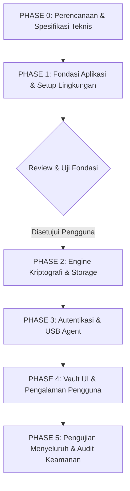

# KryptoInfo — Implementation Plan & Roadmap

> Rencana Implementasi Bertahap (Phased Implementation Plan)  
> Versi: 1.0.0 | Status: Active Working Plan

---

## 1. Ikhtisar Rencana Kerja (Phasing Strategy)

Pembangunan KryptoInfo dilakukan dengan pendekatan terstruktur per fase (*step-by-step phased execution*). Setiap fase memiliki cakupan yang terukur, pengujian mandiri (*self-contained testing*), dan evaluasi kelayakan sebelum melangkah ke fase berikutnya.

> [!IMPORTANT]
> **Aturan Eksekusi**:
> 1. Selesaikan **PHASE 0** (Perencanaan & Spesifikasi) secara menyeluruh.
> 2. Lanjutkan ke **PHASE 1** (Fondasi Aplikasi: Backend Express, Frontend React 18.3.1, Database, Healthcheck).
> 3. Jalankan dan uji fondasi backend dan frontend.
> 4. **DILARANG memulai PHASE 2** sebelum mendapatkan instruksi dan persetujuan eksplisit dari pengguna.

---

## 2. Rincian Fase Implementasi

---

### PHASE 0: Perencanaan Teknis & Penyelarasan Spesifikasi
*Status: Sedang Berjalan / Siap Validasi*

- [x] **0.1**: Inspeksi menyeluruh lingkungan kerja (Windows 11, Node.js v24.15.0, Git 2.47.1, npm 10.9.0).
- [x] **0.2**: Penegakan aturan proyek `AGENTS.md` (React 18.3.1, Express, MySQL, pemisahan frontend-backend-USB).
- [x] **0.3**: Pembuatan 3 project skills (`crypto-security-engineer`, `react18-frontend`, `testing-code-review`).
- [x] **0.4**: Pembuatan dokumentasi lingkungan awal (`ENVIRONMENT_CHECK.md`, `DEVELOPMENT_SETUP.md`, `TOOLS_AND_SKILLS.md`).
- [x] **0.5**: Verifikasi kesiapan Context7 MCP.
- [x] **0.6**: Pembuatan dokumen arsitektur dan spesifikasi teknis (`ARCHITECTURE.md`, `SECURITY_MODEL.md`, `REQUIREMENTS_MAPPING.md`, `IMPLEMENTATION_PLAN.md`).
- [ ] **0.7**: Penerimaan dan analisis Master Prompt KryptoInfo dari pengguna.

---

### PHASE 1: Fondasi Aplikasi (Application Foundation)
*Status: Siap Dikerjakan setelah Master Prompt Diterima*

- **1.1. Fondasi Backend (Node.js & Express)**:
  - Inisialisasi `backend/package.json` dengan dependensi inti: `express`, `dotenv`, `cors`, `helmet`, `morgan`, dan Prisma ORM v7 (`@prisma/client@7` / driver adapter kompatibel MariaDB).
  - Dependensi pengujian: `jest`, `supertest`.
  - Struktur direktori modular: `src/{controllers,routes,services,middleware,config,crypto}`.
  - Implementasi middleware dasar: error handler terpusat, security headers via Helmet, JSON body parser.
  - Endpoint kesehatan (*Health Check*): `GET /api/health` yang mengembalikan status sistem dan timestamp.
  - Unit test awal untuk endpoint health check.
- **1.2. Fondasi Frontend (React 18.3.1 + Vite)**:
  - Inisialisasi `frontend/` menggunakan Vite dengan template React.
  - Penguncian versi tepat: `"react": "18.3.1"`, `"react-dom": "18.3.1"`.
  - Struktur direktori modular: `src/{components,pages,hooks,services,context,styles,assets}`.
  - Setup styling dasar: Palet warna modern/cyber-security (dark mode, glassmorphism, accent neon/cyan, tipografi profesional).
  - Tampilan dasar aplikasi (Landing/Dashboard shell dengan status koneksi ke Backend).
  - Test dasar komponen UI dengan Vitest / Testing Library.
- **1.3. Konfigurasi Database (MariaDB XAMPP + Prisma ORM v7)**:
  - Konfigurasi `prisma/schema.prisma` dengan `provider = "mysql"` yang menargetkan MariaDB XAMPP (`127.0.0.1:3306`), database `kryptoinfo`, akun bawaan `root` tanpa password.
  - Modul client database `backend/src/config/db.js` yang menginisialisasi PrismaClient secara aman.
  - Kredensial dibaca dari `backend/.env` (`DATABASE_URL="mysql://root:@127.0.0.1:3306/kryptoinfo"`).
  - Prosedur non-destruktif: tidak ada pembuatan user baru/GRANT, dan tidak ada reset atau penghapusan tabel/database yang sudah ada.
- **1.4. Validasi Fondasi**:
  - Menjalankan backend server dan frontend dev server secara bersamaan.
  - Verifikasi komunikasi API antara Frontend dan Backend.
  - Eksekusi pengujian automated test pada Backend dan Frontend.

---

### PHASE 2: Engine Kriptografi & Manajemen Penyimpanan
*(Menunggu instruksi eksplisit pengguna)*

- **2.1**: Implementasi modul `backend/src/crypto/aes.js` (AES-256-GCM enkripsi dan dekripsi berkas).
- **2.2**: Validasi authentication tag (128-bit) dan generator IV unik (96-bit CSPRNG).
- **2.3**: Layanan penyimpanan berkas terisolasi (`backend/storage/vault`).
- **2.4**: API upload dan download berkas terenkripsi (`/api/vault/*`).
- **2.5**: Pengujian ketat: Happy path, tamper detection test, IV uniqueness test, zero-length input test.

---

### PHASE 3: Autentikasi Pengguna & Integrasi USB Agent
*(Menunggu instruksi eksplisit pengguna)*

- **3.1**: Modul registrasi dan login dengan hashing password (Argon2id/bcrypt).
- **3.2**: Service daemon USB Agent terpisah (`usb-agent/`).
- **3.3**: Protokol Challenge-Response antara Backend, Frontend, dan USB Agent.
- **3.4**: Mode Virtual Dongle / Development Key untuk pengujian tanpa perangkat fisik.
- **3.5**: Pengujian alur otentikasi lengkap (2FA challenge).

---

### PHASE 4: Antarmuka Vault & Pengalaman Pengguna (UI/UX)
*(Menunggu instruksi eksplisit pengguna)*

- **4.1**: Komponen UI Vault Dashboard (File Explorer, drag-and-drop encryption dropzone).
- **4.2**: Status visual USB Dongle (Connected, Disconnected, Authenticating, Locked).
- **4.3**: Komponen visual Audit Log.
- **4.4**: Optimasi aksesibilitas (WCAG 2.1 AA) dan responsivitas layar (mobile, tablet, desktop).

---

### PHASE 5: Pengujian Menyeluruh, Audit Keamanan, & Dokumentasi Akhir
*(Menunggu instruksi eksplisit pengguna)*

- **5.1**: Eksekusi seluruh rangkaian pengujian (Unit, Integration, End-to-End API test).
- **5.2**: Verifikasi kepatuhan terhadap checklist `crypto-security-engineer` dan `testing-code-review`.
- **5.3**: Pembuatan laporan akhir pengujian dan dokumentasi penggunaan `README.md`.

---

## 3. Log Perubahan Rencana

| Tanggal | Versi | Perubahan | Oleh |
|---|---|---|---|
| 01-11-2026 | 1.0.0 | Penyusunan draf awal rencana implementasi 5 fase | Antigravity AI |
